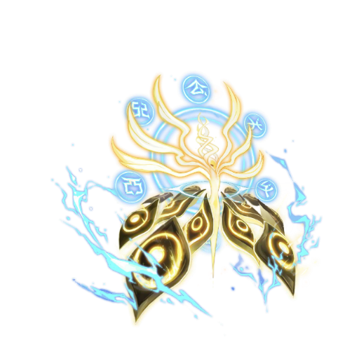

# 谱尼 · 七重封印 / PuniMod

《杀戮尖塔2》独立角色同人 Mod，以《赛尔号》至高真神·谱尼为原型。

> **Mod v0.4.1 已在 Windows 游戏 v0.111.0 和 v0.113.0 测试分支验证。** 需要 BaseLib 3.4.8 或更新版本及其 Compatibility Helper。[BaseLib 下载](https://github.com/Alchyr/BaseLib-StS2/releases/tag/v3.4.8)
>
> **角色强度很高，可能影响游戏平衡、流程及与其他 Mod 的交互。请酌情下载使用。**
>
> 本 Mod 偏向高强度、爽玩的角色体验。新版实验模式和多人联机尚未验证。

## 基础信息

|项目|内容|
|---|---|
|已验证的游戏版本|Slay the Spire 2 v0.111.0、v0.113.0 测试分支（Windows）|
|当前 Mod 版本|v0.4.1|
|前置依赖|BaseLib 3.4.8 或更新版本，含 Compatibility Helper|
|卡牌|91张：基础4、白20、蓝38、金27、先古2|
|能力与刻印|20张能力牌，57张刻印卡|
|专属遗物|4件，包含初始遗物的先古升级版|
|先古对白|9位先古各3段，共27段115句|
|初始属性|生命99，金币99；打击6伤害，防御5格挡|

## 玩法

累积圣灵，每3点依次解开虚无、元素、能量、生命、轮回、永恒、圣洁七道封印；解封后可激活卡牌自带的刻印效果。超过21点后，每额外7点圣灵触发一次脉冲：7点全体固定伤害和7点格挡。

可围绕刻印、裂空圣痕、力量、解封时的能力收益，以及消耗状态牌与废牌构筑。最新九张重做说明见[本次九张卡牌重做](本次九张卡牌重做.md)，完整数值见[完整卡表](完整卡表.md)。

## 下载与安装

### Steam 创意工坊

订阅谱尼与 BaseLib，在游戏模组列表启用谱尼、BaseLib 和 BaseLib Compatibility Helper，按提示重启。[谱尼工坊页面](https://steamcommunity.com/sharedfiles/filedetails/?id=3836800347) · [BaseLib 工坊页面](https://steamcommunity.com/sharedfiles/filedetails/?id=3737335127)

### GitHub Release 手动安装

1. 完全退出游戏，下载并解压 Windows 安装包。[v0.4.1 下载](https://github.com/Suzakuin/SlayTheSpire2-PuniMod/releases/tag/v0.4.1)
2. 运行包内安装脚本，或将 `mods/PuniMod` 复制到游戏的 `mods` 目录。
3. 首次手动安装 BaseLib 时，将包内 `mods/BaseLib` 也复制到游戏的 `mods` 目录。若已有旧版 BaseLib，请先更新至 3.4.8 或更高，并确认兼容组件已安装。
4. 在模组列表启用谱尼、BaseLib 和 BaseLib Compatibility Helper，按提示重启后选择谱尼。

手动副本与工坊副本请只保留一种加载方式，避免重复 Mod ID。安装包内也有 Windows 安装脚本；自定义游戏目录可使用 Install-PuniMod.ps1 -GameDir '游戏目录'。

## 兼容范围与反馈

**角色强度很高，可能影响游戏平衡、流程及与其他 Mod 的交互。请酌情下载使用。**

- v0.111.0 和 v0.113.0 均通过单人卡牌、刻印、遗物及角色场景回归。v0.113.0 还验证了封印加速的回合推进、先古对白和建筑师结局。[验证记录](验证记录.md)
- 新版实验模式、多人联机及全部 Mod 组合尚未验证。
- 如遇问题，请在 Issues 提供游戏版本、Mod版本、启用的其他Mod及复现步骤；公开日志前请删除个人信息。

## 从源码构建

需要 .NET 9 SDK、Godot 4.5.1 和游戏 v0.113.0。运行以下命令。

    .\Build.ps1 -GameDir '你的 Slay the Spire 2 安装目录' -GodotPath 'Godot 可执行文件路径'

BaseLib 的依赖和 MIT 许可位于 dependencies/。构建结果位于 dist/PuniMod/。

## 素材与鸣谢

- 非官方同人作品，与淘米、Mega Crit无隶属关系。谱尼角色、赛尔号立绘和技能素材的权利归原权利方。
- 人物使用至高真神·谱尼的64帧/24FPS待机动态，未提供独立攻击、受击、死亡动画；没有新增配音。
- 91张卡图取自赛尔号官网原有技能与人物动画静帧，详见[卡图来源](卡图来源.md)。Q版头像为AI生成的同人形象。
- 感谢 [Alchyr / BaseLib](https://github.com/Alchyr/BaseLib-StS2)，MIT 许可随源码与发行包保留。
